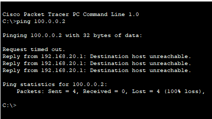
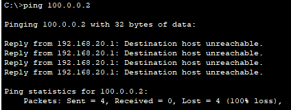
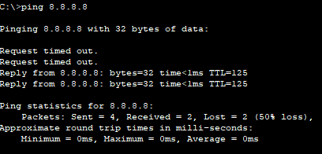

# Отчет по лабораторной работе №2
**Тема:** Настройка удаленного доступа SSH, DHCP, NAT и списков контроля доступа (ACL)
**Выполнил:** Канайкин А. А., Лобанцов А. О., гр. 409 

## Топология


## Ответы на вопросы

### Часть 2: Настройка удаленного доступа по протоколу SSH

**Вопрос 1.** Какой вариант подключения не сработал и почему?

**Ответ:** Не сработал вариант **Telnet**. Это связано с тем, что на виртуальных линиях (VTY) маршрутизатора R1 мы принудительно разрешили подключение только по протоколу SSH командой `transport input ssh`. Эта команда блокирует любые попытки подключения по незащищенному протоколу Telnet, так как он передает данные (включая пароли) в открытом виде.

### Часть 3: Автоматическая настройка IP-адресов по протоколу DHCP

**Вопрос 2.** Какие IP-адрес R2 и маску сети получил? Появился ли маршрут по умолчанию? Если да, то через какой next-hop он ведет?

**Ответ:** R2 получил IP-адрес `192.168.20.2` с маской `255.255.255.0` (или `/24`). 
Да, маршрут по умолчанию появился. Он ведет через `next-hop` **`192.168.20.1`** (адрес интерфейса R1, который раздает DHCP).

```text
R2# show ip interface Gi0/0
GigabitEthernet0/0 is up, line protocol is up (connected)
  Internet address is 192.168.20.2/24
  Broadcast address is 255.255.255.255
  Address determined by DHCP
  MTU is 1500 bytes
  Helper address is not set
  Directed broadcast forwarding is disabled
  Outgoing access list is not set
  Inbound  access list is not set
  Proxy ARP is enabled
  Security level is default
  Split horizon is enabled
  ICMP redirects are always sent
  ICMP unreachables are always sent
  ICMP mask replies are never sent
  IP fast switching is disabled
  IP fast switching on the same interface is disabled
  IP Flow switching is disabled
  IP Fast switching turbo vector
  IP multicast fast switching is disabled
  IP multicast distributed fast switching is disabled
  Router Discovery is disabled
  IP output packet accounting is disabled
  IP access violation accounting is disabled
  TCP/IP header compression is disabled
  RTP/IP header compression is disabled
  Probe proxy name replies are disabled
  Policy routing is disabled
  Network address translation is disabled
  BGP Policy Mapping is disabled
  Input features: MCI Check
  WCCP Redirect outbound is disabled
  WCCP Redirect inbound is disabled
  WCCP Redirect exclude is disabled

R2# show ip route
Codes: L - local, C - connected, S - static, R - RIP, M - mobile, B - BGP
       D - EIGRP, EX - EIGRP external, O - OSPF, IA - OSPF inter area
       N1 - OSPF NSSA external type 1, N2 - OSPF NSSA external type 2
       E1 - OSPF external type 1, E2 - OSPF external type 2, E - EGP
       i - IS-IS, L1 - IS-IS level-1, L2 - IS-IS level-2, ia - IS-IS inter area
       * - candidate default, U - per-user static route, o - ODR
       P - periodic downloaded static route

Gateway of last resort is 192.168.20.1 to network 0.0.0.0

     192.168.10.0/24 is variably subnetted, 2 subnets, 2 masks
C       192.168.10.0/24 is directly connected, GigabitEthernet0/1
L       192.168.10.1/32 is directly connected, GigabitEthernet0/1
     192.168.20.0/24 is variably subnetted, 2 subnets, 2 masks
C       192.168.20.0/24 is directly connected, GigabitEthernet0/0
L       192.168.20.2/32 is directly connected, GigabitEthernet0/0
S*   0.0.0.0/0 [254/0] via 192.168.20.1
```

**Вопрос 3.** Какой IP-адрес получил ПК? Совпадают ли шлюз по умолчанию и DNS-сервер с указанными в DHCP-пуле?

**Ответ:** ПК `home` получил IP-адрес **`192.168.10.2`**. 
Да, шлюз по умолчанию (`192.168.10.1`) и DNS-сервер (`100.0.0.2`) полностью совпадают с теми параметрами, которые мы указали при создании DHCP-пула `DHCP-POOL` на маршрутизаторе R2.

**Вопрос 4.** Приведите вывод команд проверки DHCP-сервера:
*   Список привязок IPv4 к MAC-адресам (`show ip dhcp binding`).
*   Информацию о настроенных пулах (`show ip dhcp pool`).

**Ответ:** 

```text
R2# show ip dhcp binding
IP address       Client-ID/              Lease expiration        Type
                 Hardware address
192.168.10.2     0030.A330.9A20           --                     Automatic

R2# show ip dhcp pool
Pool DHCP-POOL :
 Utilization mark (high/low)    : 100 / 0
 Subnet size (first/next)       : 0 / 0 
 Total addresses                : 254
 Leased addresses               : 1
 Excluded addresses             : 1
 Pending event                  : none

 1 subnet is currently in the pool
 Current index        IP address range                    Leased/Excluded/Total
 192.168.10.1         192.168.10.1     - 192.168.10.254    1    / 1     / 254
```

**Вопрос 5.** Проверьте с ПК `home` доступность IP-адреса Server0 (`100.0.0.2`) утилитой `ping`. Попробуйте объяснить результат проверки. При необходимости перейдите в режим симуляции (Simulation), отфильтруйте протокол ICMP и проследите путь пакетов от `home` до Server0 и обратно.

**Ответ:** Пинг с ПК `home` до Server0 (`100.0.0.2`) **не проходит** (`Request timed out`). 

Это происходит потому, что ПК `home` находится в частной сети (`192.168.10.0/24`), а Server0 — во внешней сети (`100.0.0.0/30`). Пакет от `home` доходит до R2, затем до R1 и Server0, но **ответный пакет не может вернуться обратно**, так как в глобальной сети не существует маршрута к частным адресам (`192.168.10.x`). Для решения этой проблемы на R2 необходимо настроить механизм NAT (трансляцию адресов), чтобы подменять частный адрес ПК на публичный адрес интерфейса R2.



**Вопрос 6.** Повторите проверку доступности `100.0.0.2` с ПК `home`. Какой результат получен теперь?

**Ответ:** После настройки NAT (PAT) на маршрутизаторе R2 пинг с ПК `home` до Server0 (`100.0.0.2`) **проходит успешно**. R2 теперь подменяет частный IP-адрес ПК (`192.168.10.2`) на публичный адрес своего интерфейса `Gi0/0` при отправке пакета и выполняет обратную замену при получении ответа.



**Вопрос 7.** Приведите вывод таблицы трансляций на `R2` (`show ip nat translations`).

**Ответ:** 

```text
R2# show ip nat translations
Pro  Inside global     Inside local       Outside local      Outside global
icmp 192.168.20.2:57   192.168.10.2:57    100.0.0.2:57       100.0.0.2:57
icmp 192.168.20.2:58   192.168.10.2:58    100.0.0.2:58       100.0.0.2:58
icmp 192.168.20.2:59   192.168.10.2:59    100.0.0.2:59       100.0.0.2:59
icmp 192.168.20.2:60   192.168.10.2:60    100.0.0.2:60       100.0.0.2:60
```

**Вопрос 8.** Проверьте доступность узла `8.8.8.8` утилитой `ping` с ПК `home`. Объясните результат. Какие диапазоны IPv4-адресов относятся к приватным (RFC 1918)? Допустимо ли их использование в глобальной сети Интернет без трансляции?

**Ответ:** Пинг с ПК `home` до узла `8.8.8.8` **не проходит**. Это происходит потому, что на маршрутизаторе провайдера (R1) еще **не настроен механизм NAT** для выхода в глобальную сеть. Частные адреса (такие как `192.168.10.2`) не могут быть маршрутизированы в интернете, и без трансляции пакеты отбрасываются.

К приватным диапазонам IPv4 (RFC 1918) относятся:
*   `10.0.0.0/8` (10.0.0.0 – 10.255.255.255)
*   `172.16.0.0/12` (172.16.0.0 – 172.31.255.255)
*   `192.168.0.0/16` (192.168.0.0 – 192.168.255.255)

Использование этих адресов в глобальной сети Интернет **недопустимо** без трансляции, так как они зарезервированы для локальных сетей и не являются уникальными.



**Вопрос 9.** Повторите проверку доступности `8.8.8.8` и `100.0.0.2` командой `ping` с ПК `home`. Какой результат получен? Приведите вывод таблицы трансляций на `R1` (`show ip nat translations`). Почему для пакетов, идущих к `8.8.8.8`, трансляция создается, а для пакетов к `100.0.0.2` — нет?

**Ответ:** После настройки NAT на R1 пинг до `8.8.8.8` **проходит успешно** (трансляция работает). Пинг до `100.0.0.2` также **проходит успешно**, но для него трансляция **не создается**.

Трансляция не создается для пакетов к `100.0.0.2`, потому что этот адрес находится в той же сети (`100.0.0.0/30`), что и интерфейс `Gi1/0` на R1. Трафик к этому адресу маршрутизируется внутри интерфейса `inside` и не проходит через процесс NAT (`outside`), поэтому трансляция не требуется.

```text
R1# show ip nat translations
Pro  Inside global     Inside local       Outside local      Outside global
icmp 100.0.0.9:69      192.168.20.2:69    8.8.8.8:69         8.8.8.8:69
icmp 100.0.0.9:70      192.168.20.2:70    8.8.8.8:70         8.8.8.8:70
icmp 100.0.0.9:71      192.168.20.2:71    8.8.8.8:71         8.8.8.8:71
icmp 100.0.0.9:72      192.168.20.2:72    8.8.8.8:72         8.8.8.8:72
```

**Вопрос 10.** Устанавливается ли соединение? Как такую ситуацию можно охарактеризовать с точки зрения информационной безопасности?

**Ответ:** Да, соединение по SSH с ПК `home` к R1 (`192.168.20.1`) **устанавливается**. 

С точки зрения информационной безопасности это является **уязвимостью**, так как любой пользователь из транзитной (клиентской) сети может получить доступ к управлению маршрутизатором. Это нарушает принцип разграничения доступа и создает риск несанкционированного изменения конфигурации, что может привести к сбоям в работе сети или компрометации данных.
```

**Вопрос 11.** Опишите полученные результаты. Что изменилось?

**Ответ:** После применения стандартного ACL `TO-MGMT` к линиям VTY маршрутизатора R1:
*   С ПК `home` (находящегося в сети `192.168.20.0/24`) подключение по SSH **перестало устанавливаться** — доступ заблокирован.
*   С ПК `admin` (находящегося в сети `192.168.10.0/24`) подключение по SSH **продолжает работать**.

**Что изменилось:** Доступ к управлению маршрутизатором R1 теперь разрешен только из доверенной админской сети (`192.168.10.0/24`). Это повышает безопасность, так как исключает возможность несанкционированного доступа из клиентской (транзитной) сети.
```

**Вопрос 12.** Приведите результат выполнения команды `show ip access-lists TO-SERVER`.

**Ответ:** 

```text
R1# show ip access-lists TO-SERVER
Extended IP access list TO-SERVER
    permit ip 192.168.10.0 0.0.0.255 100.0.0.0 0.0.0.3
    permit udp any host 100.0.0.2 eq domain
    permit udp any eq domain host 100.0.0.2
    permit tcp any host 100.0.0.2 eq www
    permit icmp 192.168.10.0 0.0.0.255 host 100.0.0.2
```

**Вопрос 13.** Какое правило созданного списка доступа блокирует эхо-запросы от ПК `home`?

**Ответ:** Эхо-запросы (ICMP) от ПК `home` блокирует правило **`deny ip any any`** (неявный запрет в конце списка), так как в ACL `TO-SERVER` разрешены ICMP-запросы только из сети `192.168.10.0/24` (правило `permit icmp 192.168.10.0 0.0.0.255 host 100.0.0.2 echo`), а ПК `home` находится в сети `192.168.20.0/24`. Пакеты от `home` не подходят ни под одно разрешающее правило и отбрасываются неявным запретом.
```

**Вопрос 14.** Снова выведите статистику списка доступа командой `show ip access-lists TO-SERVER`. Изучите счетчики совпадений (`matches`). Какое из созданных правил является избыточным (бесполезным) и почему?

**Ответ:** После проверки веб-доступа с обоих ПК (переход на `portal.isp.net` и `google.com`), избыточным является правило **`permit udp host 100.0.0.2 any eq domain`** (разрешающее серверу получать ответы от внешних DNS-серверов). 

Это правило **не используется** (счетчик совпадений `matches` равен 0), потому что в данной топологии сервер `100.0.0.2` не инициирует DNS-запросы к внешним серверам. Он только отвечает на запросы клиентов, а для этого достаточно правила `permit udp any host 100.0.0.2 eq domain`.

```text
R1# show ip access-lists TO-SERVER
Extended IP access list TO-SERVER
    permit ip 192.168.10.0 0.0.0.255 100.0.0.0 0.0.0.3
    permit udp any host 100.0.0.2 eq domain
    permit udp any eq domain host 100.0.0.2
    permit tcp any host 100.0.0.2 eq www
    permit icmp 192.168.10.0 0.0.0.255 host 100.0.0.2
```

**Вопрос 15.** Почему маршрутизатор `R1` успешно синхронизирует время с сервером, несмотря на то, что в исходящем списке доступа `TO-SERVER` на интерфейсе `Gi1/0` отсутствует разрешающее правило для протокола NTP?

**Ответ:** Маршрутизатор R1 успешно синхронизирует время, потому что список доступа `TO-SERVER` применяется на интерфейсе `Gi1/0` в направлении **`out`** и фильтрует только **транзитный** трафик, проходящий через маршрутизатор. 

Трафик NTP **генерируется самим маршрутизатором R1** (локально), а не проходит через него. Поэтому он не попадает под действие ACL, и запросы к NTP-серверу (100.0.0.2) отправляются беспрепятственно.