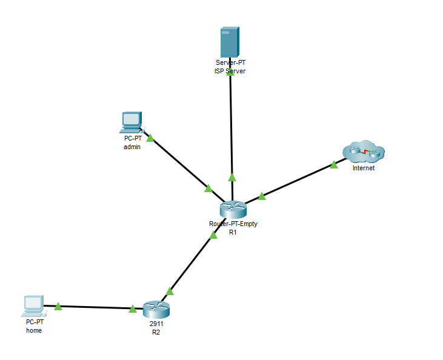

# Отчет по лабораторной работе N2

**Тема:** Настройка базовой конфигурации, SSH, DHCP, NAT и ACL в Cisco Packet Tracer

**Выполнил:** Лобанцов А. О. и Канайкин А. А., гр. 409  

## Топология



## Ответы на вопросы

1. Ответ на вопрос.
2. Ответ на вопрос.
Продолжение ответа.
```text
тут должен быть листинг команд
```
3. Ответ на вопрос.

